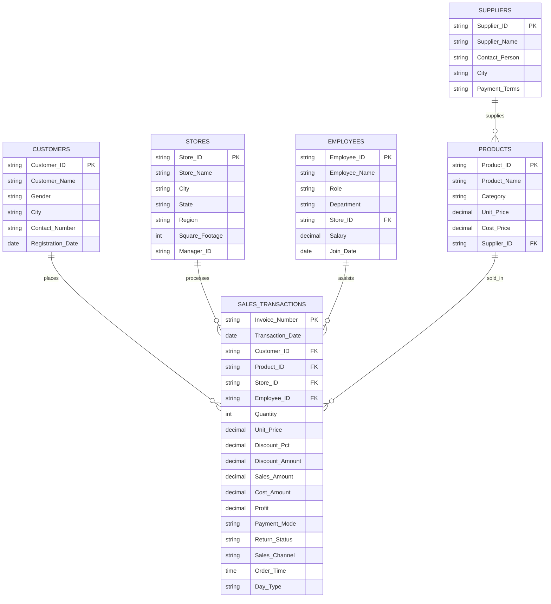

# 🛍️ FreshMart Enterprise Analytics Project

Comprehensive retail sales analytics, relational data modeling, and executive KPI dashboard developed for **FreshMart**, a multi-branch supermarket retail enterprise.

---

## 📌 Project Overview

FreshMart operates multiple supermarket branches offering diverse product categories (Groceries, Fresh Produce, Dairy, Beverages, Personal Care, Household). This project models the complete business intelligence pipeline: from raw operational exports to cleaned and validated records, ending in an interactive, dynamic Excel executive dashboard.

---

## 🏗️ Relational Schema & Data Architecture

The project connects 6 relational business entities into a star/snowflake schema inside Excel:



---

## 📂 Folder Structure & File Inventory

```text
FreshMart/
├── README.md                           # This comprehensive project documentation
└── 📁 src/                             # Source files, dashboard models & datasets
    ├── freshmart.dashboard.xlsx        # Master interactive Excel workbook with dashboards & KPI models
    ├── 📁 CLEANED/                     # Transformed, audited & analysis-ready data
    │   ├── freshmart.dashboard.xlsx    # Cleaned production dashboard copy
    │   └── FreshMart_Sales_Transactions (1).xlsx # Validated transaction records
    └── 📁 RAW/                         # Original source spreadsheets
        ├── FreshMart_Customers.xlsx    # Customer demographics & loyalty records
        ├── FreshMart_Employess.xlsx    # Store employee staff roster
        ├── FreshMart_Enterprise_Dataset.xlsx # Consolidated multi-sheet master file
        ├── FreshMart_Products.xlsx     # Catalog of SKUs, pricing & supplier links
        ├── FreshMart_Sales_Transactions.xlsx # Raw POS sales logs
        ├── FreshMart_Stores.xlsx       # Store branches & retail square footage
        └── FreshMart_Suppliers.xlsx    # Supplier directory & lead terms
```

---

## 📊 Core Business KPIs & Formulas

Inside `freshmart.dashboard.xlsx`, dynamic formulas and Pivot Tables calculate the key operational and financial indicators:

1. **Total Gross Revenue**:  
   $$\text{Total Sales} = \sum (\text{Quantity} \times \text{Unit Price} \times (1 - \text{Discount Pct}))$$
2. **Total Cost of Goods Sold (COGS)**:  
   $$\text{Total COGS} = \sum (\text{Quantity} \times \text{Cost Price})$$
3. **Gross Profit & Profit Margin %**:  
   $$\text{Profit} = \text{Sales Amount} - \text{Cost Amount}$$  
   $$\text{Margin \%} = \frac{\text{Profit}}{\text{Sales Amount}} \times 100$$
4. **Average Order Value (AOV)**:  
   $$\text{AOV} = \frac{\text{Total Sales Amount}}{\text{Total Unique Invoices}}$$
5. **Discount Impact**: Total revenue waived through promotional campaigns.
6. **Sales Channel Mix**: Revenue share of **In-Store** vs. **Online Delivery**.
7. **Temporal Trends**: Revenue volume analyzed by **Day Type** (*Weekday* vs. *Weekend*) and hourly peak trading intervals (*Order Time*).

---

## 🖥️ Executive Dashboard Features

* **KPI Summary Scorecards**: Total Revenue, Gross Profit, Total Volume Sold, Average Transaction Size, and Active Store Branches.
* **Interactive Slicers**: Store Branch, Product Category, Payment Mode (Cash, Wallet, Card, UPI), and Time Period.
* **Visualizations**:
  * Category-wise Revenue & Margin Bar Charts.
  * Monthly Sales Run-rate & Seasonality Line Charts.
  * Store Performance Benchmarking Column Charts.
  * Payment Method & Return Rate Donut Charts.

---

## 🛠️ Usage Instructions

1. Open `src/freshmart.dashboard.xlsx` in **Microsoft Excel (2016 or newer)**.
2. Ensure macros/data connections are enabled if prompted.
3. Navigate to the `Dashboard` tab to interact with visual filters and examine real-time KPI card updates.
4. Review the `KPI VALUES` and supporting entity sheets (`Supplier`, `Store`, `Products`, `Employee`, `Customer`) to inspect the underlying `XLOOKUP` and Pivot logic.
