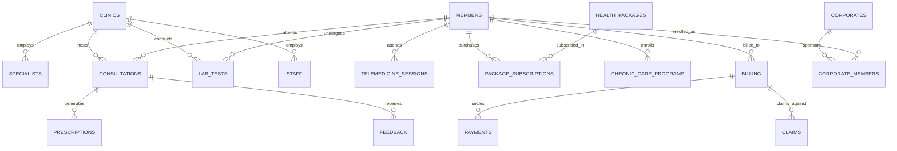

# 🩺 HealthPlus Care Database & Analytics Project

Comprehensive relational database architecture, ETL cleansing routines, data integrity validation, and business intelligence reporting for **HealthPlus Care** (`Healthplus_care`), a multi-specialty outpatient healthcare network.

---

## 📌 Project Overview

HealthPlus Care manages an integrated network of outpatient clinics, telemedicine consultation services, diagnostic laboratories, corporate wellness memberships, and chronic disease management programs. This project establishes the entire SQL database lifecycle: from schema design (DDL) and CSV ingestion to automated integrity audits, data cleaning (DML), and 29 critical executive business intelligence queries.

---

## 🏗️ Relational Schema & Entity-Relationship Architecture

The database models 17 normalized relational tables:



---

## 📂 Folder Structure & File Inventory

```text
HealthPlus/
├── README.md                           # This comprehensive project documentation
├── 📁 CSV files/                       # 17 normalized CSV datasets ready for database import
│   ├── Clinics.csv                     # Clinic branches, locations & establish dates
│   ├── Specialists.csv                 # Doctors, credentials, specialties & fee schedules
│   ├── Members.csv                     # Patient demographics, contact info & member tiers
│   ├── Corporates.csv                  # Corporate partners & contract terms
│   ├── Corporate_Members.csv           # Association of corporate employees to memberships
│   ├── Consultations.csv               # Clinic consultation records, diagnoses & fees
│   ├── Telemedicine_Sessions.csv       # Virtual video sessions, duration & connection quality
│   ├── Lab_Tests.csv                   # Diagnostic test orders, results & charges
│   ├── Prescriptions.csv               # Medications prescribed per consultation
│   ├── Health_Packages.csv             # Preventive healthcare checkup bundles & prices
│   ├── Package_Subscriptions.csv       # Member subscriptions to health packages
│   ├── Chronic_Care_Programs.csv       # Disease management enrollments (Diabetes, Cardiac, etc.)
│   ├── Billing.csv                     # Itemized billing invoices & totals
│   ├── Payments.csv                    # Payment transactions, payment modes & status
│   ├── Claims.csv                      # Insurance claims submitted & approved amounts
│   ├── Feedback.csv                    # Patient ratings, wait times & comments
│   └── Staff.csv                       # Administrative & support personnel
├── 📁 Queries/                         # Production SQL scripts
│   ├── Healthplus.sql                  # DDL: Schema creation, tables, PKs & datatypes
│   ├── Data Validation.sql             # Diagnostic queries: Uniqueness, NULLs & FK constraints
│   ├── Data Cleaning.sql               # DML: String formatting, date casting & cleanups
│   └── Business Questions.sql          # 29 Advanced BI queries answering operational questions
└── 📁 Raw/                             # Source operational data
    └── HealthPlus_Care_DB_dataset.xlsx # Master unnormalized Excel workbook
```

---

## 📜 Complete SQL Lifecycle Scripts

### 1. DDL Schema Definition (`Healthplus.sql`)
Defines the `Healthplus_care` database and creates the 17 tables with exact primary keys, appropriate data types (`VARCHAR`, `INT`, `DECIMAL(10,2)`), and indexing.

### 2. Diagnostic Integrity Validation (`Data Validation.sql`)
* **Primary Key Uniqueness**: Validates zero duplication on IDs across all 17 tables.
* **Referential Integrity**: Detects orphaned consultations, bills with missing patient IDs, and unmapped prescriptions.
* **Sanity Checks**: Identifies negative fees, future-dated appointments, or missing dates.

### 3. Data Cleaning & Transformation (`Data Cleaning.sql`)
* Standardizes dates stored as text into structured `DATE` formats using `STR_TO_DATE()`.
* Strips leading/trailing whitespace from names and contact info using `TRIM()`.
* Normalizes categorical status fields (`Paid`, `Pending`, `Approved`, `Rejected`).

---

## 💡 Executive Business Questions Answered (`Business Questions.sql`)

The repository features 29 business queries categorized by operational domain:

### Operational & Clinical Workload
1. **Clinic Consultation Volume**: Ranks clinics with the highest outpatient consultation volume.
2. **Specialist Consultation Workload**: Identifies doctors managing the highest patient load.
3. **High-Demand Specializations**: Aggregates consultation volume by medical department (Cardiology, Dermatology, Orthopedics, Pediatrics).
4. **Active Members**: Highlights frequent healthcare users and utilization patterns.
5. **Consultation Modes**: Compares In-Person visits vs. Virtual Telemedicine sessions.
6. **Reasons for Visit**: Identifies top primary complaints and presenting symptoms.
7. **Consultation Statuses**: Evaluates cancelled, completed, and no-show consultation rates.

### Telemedicine & Virtual Care
8. **Telemedicine Volume & Completion**: Analyzes completion vs. dropout rates for digital visits.
9. **Platform & Quality Distribution**: Audits connection quality across video platforms (Zoom, Meet, WebRTC).
10. **Average Session Duration**: Calculates mean consultation length in minutes.

### Wellness & Chronic Care
11. **Chronic Care Enrollments**: Ranks disease programs (Hypertension, Type-2 Diabetes, Asthma) by patient count.
12. **Specialist Case Loads**: Doctors managing the largest chronic-care patient panels.
13. **Health Package Subscriptions**: Top-selling preventive health checkup bundles.
14. **Subscription Expiry Pipeline**: Identifies subscriptions approaching or past expiry dates.

### Corporate Partnerships
15. **Corporate Member Contributions**: Ranks companies providing the highest enrolled employee volume.
16. **Industry Participation**: Compares healthcare adoption across industries (IT, Manufacturing, Finance).

### Pharmacy, Diagnostics & Insurance
17. **Top Prescribed Medicines**: Most frequently dispensed pharmaceutical items.
18. **Prescription Volume by Specialist**: Doctors issuing the highest prescription volume.
19. **High-Cost Diagnostic Lab Tests**: Identifies top revenue-generating pathology and imaging tests.
20. **Clinic Laboratory Workload**: Benchmarks lab test processing volume across clinic branches.
21. **Top Insurance Providers**: Insurers with highest submitted and approved claim volumes.
22. **Claim Status Distribution**: Ratio of Approved vs. Under-Review vs. Rejected claims.

### Revenue, Billing & Patient Experience
23. **Total Billed Revenue Split**: Decomposes total revenue into Consultation, Lab, and Medicine charges.
24. **Payment Collections by Mode**: Analyzes collections via Credit Card, UPI, Net Banking, and Cash.
25. **Validated Collection Gap**: Measures total unpaid outstanding receivables (`Billed - Paid`).
26. **Clinic & Doctor Ratings**: Identifies highest- and lowest-rated clinics and physicians based on patient reviews.
27. **Missing Feedback Audits**: Flags completed consultations lacking patient feedback.
28. **Dormant Registrations**: Identifies registered members who have never attended a consultation.
29. **High-Activity / Low-Margin Risk Areas**: Spots departments with high clinical workloads but poor financial yields or low patient satisfaction.

---

## 🏃 Setup & Execution Guide

```sql
-- 1. Create Schema
SOURCE C:/Angel/03_SQL/Projects/HealthPlus/Queries/Healthplus.sql;

-- 2. Load CSV Datasets (Example)
LOAD DATA LOCAL INFILE 'C:/Angel/03_SQL/Projects/HealthPlus/CSV files/Clinics.csv'
INTO TABLE clinics
FIELDS TERMINATED BY ',' ENCLOSED BY '"' LINES TERMINATED BY '\n' IGNORE 1 ROWS;

-- 3. Run Validation & Cleaning
SOURCE C:/Angel/03_SQL/Projects/HealthPlus/Queries/Data Validation.sql;
SOURCE C:/Angel/03_SQL/Projects/HealthPlus/Queries/Data Cleaning.sql;

-- 4. Execute Business Intelligence Queries
SOURCE C:/Angel/03_SQL/Projects/HealthPlus/Queries/Business Questions.sql;
```
