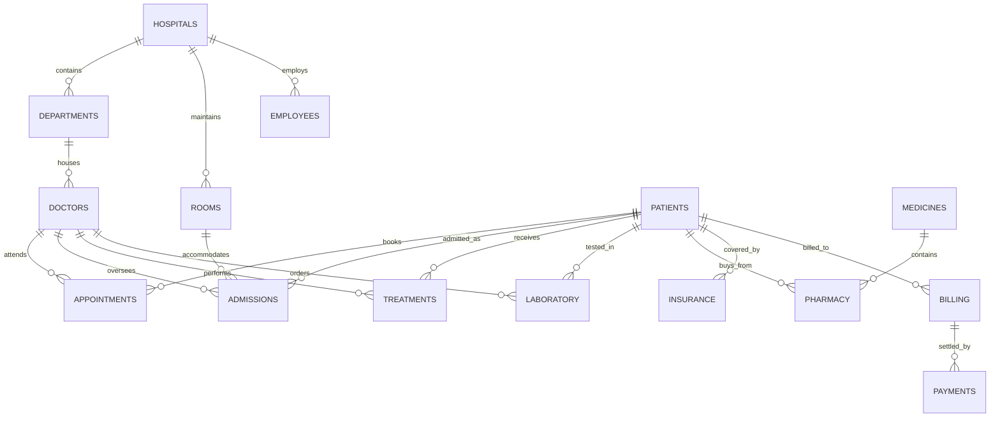

# 🏥 Medicare Hospital Analytics Project

Production-grade relational database architecture, automated validation audits, data cleaning pipelines, and clinical business intelligence queries for **Medicare Hospital Analytics** (`HospitalAnalyticsDB`).

---

## 📌 Project Overview

Medicare Hospital Analytics models a multi-hospital healthcare conglomerate managing inpatient admissions, clinical departments, physician staffing, diagnostic laboratories, inpatient bed capacity, surgical treatments, pharmacy distribution, and insurance billing. This project encompasses schema creation (DDL), CSV data ingestion, data health auditing, DML standardization, and 16 business intelligence queries.

---

## 🏗️ Relational Schema & Entity-Relationship Architecture

The database models 15 interconnected relational tables:



---

## 📂 Folder Structure & File Inventory

```text
Medicare/
├── README.md                           # This comprehensive project documentation
├── 📁 CSV files/                       # 15 normalized CSV datasets ready for database import
│   ├── Hospitals.csv                   # Multi-facility hospital directory & bed capacities
│   ├── Departments.csv                 # Clinical departments & floor allocations
│   ├── Doctors.csv                     # Physician credentials, specialties & fees
│   ├── Employees.csv                   # Nursing, lab techs & administrative staff
│   ├── Rooms.csv                       # Hospital beds, room types (ICU/General) & daily rates
│   ├── Patients.csv                    # Patient demographic records & emergency contacts
│   ├── Appointments.csv                # Outpatient scheduled appointments & statuses
│   ├── Admissions.csv                  # Inpatient admission logs, discharge dates & rooms
│   ├── Treatments.csv                  # Medical procedures, surgeries & treatment costs
│   ├── Laboratory.csv                  # Pathology orders, lab costs & test results
│   ├── Pharmacy.csv                    # Medication dispensation records & billing
│   ├── Medicines.csv                   # Drug inventory, dosage formulations & unit prices
│   ├── Insurance.csv                   # Patient insurance policies & coverage caps
│   ├── Billing.csv                     # Itemized inpatient invoices & total fees
│   └── Payments.csv                    # Patient payment transactions & payment modes
├── 📁 Queries/                         # Complete SQL script suite
│   ├── medicare.sql                    # DDL: Database creation & 15 table schemas
│   ├── Data Validation.sql             # Diagnostic queries: PKs, NULLs, dates & orphaned records
│   ├── Data Cleaning.sql               # DML: String trimming, date format normalization & updates
│   └── Business Questions.sql          # 16 Advanced BI queries on operational performance
└── 📁 Raw/                             # Source enterprise data
    └── Hospital_Analytics_DB_dataset.raw.xlsx # Raw master multi-tab spreadsheet
```

---

## 📜 Complete SQL Lifecycle Scripts

### 1. DDL Schema Definition (`medicare.sql`)
Creates the `HospitalAnalyticsDB` database and defines the 15 relational tables with strict constraints, primary keys (`hospital_id`, `department_id`, `doctor_id`, `admission_id`, etc.), and correct column datatypes.

### 2. Diagnostic Integrity Validation (`Data Validation.sql`)
* **Uniqueness Audits**: Checks for duplicate IDs across `hospitals`, `doctors`, `patients`, and `billing`.
* **Referential Integrity**: Checks that all `patient_id` references in `admissions` and `treatments` exist in `patients`.
* **Logical Consistency**: Validates that `discharge_date` $\ge$ `admission_date` and room daily rates are greater than zero.

### 3. Data Cleaning & Transformation (`Data Cleaning.sql`)
* Parses text-based dates into standard SQL `DATE` format using `STR_TO_DATE()`.
* Cleans department naming variations (e.g., 'Cardio' vs. 'Cardiology').
* Trims leading and trailing spaces on contact numbers and names.

---

## 💡 Executive Business Questions Answered (`Business Questions.sql`)

The repository features 16 analytical queries answering critical clinical and managerial questions:

1. **Hospital Operational Activity**: Ranks hospital branches by patient admission volume and outpatient visits.
2. **Departmental Workload**: Identifies clinical departments experiencing the heaviest patient traffic.
3. **Doctor Workload Distribution**: Measures consultations and treatment procedures per physician.
4. **High-Utilization Patients**: Highlights frequent-flyer patients requiring recurring medical care.
5. **Admission Volumes by Facility**: Evaluates inpatient intake across regional hospital branches.
6. **Admission Type & Status Breakdown**: Analyzes Emergency vs. Elective vs. Urgent admission proportions.
7. **Average Length of Stay (ALOS)**: Computes the mean hospital stay duration per department and diagnosis:
   $$\text{ALOS} = \frac{\sum (\text{Discharge Date} - \text{Admission Date})}{\text{Total Inpatient Admissions}}$$
8. **Room Capacity & Status Distribution**: Measures current occupancy rates across ICU, Private, and General wards.
9. **High-Cost Medical Treatments**: Identifies surgical and specialized treatments driving hospital costs and revenue.
10. **Laboratory Diagnostic Volume & Spend**: Analyzes top diagnostic tests performed and aggregate test spend.
11. **Pharmacy Utilization & Revenue**: Tracks highest-volume medications and total pharmaceutical turnover.
12. **Total Healthcare Network Revenue**: Calculates total billed charges across room fees, doctor fees, lab, and medicines.
13. **Billing Cost Breakdown**: Analyzes percentage contribution of room rent, physician fees, lab tests, and medications toward final bills.
14. **Payment Collection Performance**: Evaluates total payments received against total amounts billed.
15. **Collection Gap Analysis**: Identifies overdue balances and outstanding receivable exposure.
16. **Payment Methods & Settlement Efficacy**: Compares payment velocity across Insurance Claims, Credit Cards, Cash, and Online gateways.

---

## 🏃 Setup & Execution Guide

```sql
-- 1. Create Database & Tables
SOURCE C:/Angel/03_SQL/Projects/Medicare/Queries/medicare.sql;

-- 2. Ingest CSV Data (Example)
LOAD DATA LOCAL INFILE 'C:/Angel/03_SQL/Projects/Medicare/CSV files/Hospitals.csv'
INTO TABLE hospitals
FIELDS TERMINATED BY ',' ENCLOSED BY '"' LINES TERMINATED BY '\n' IGNORE 1 ROWS;

-- 3. Run Validation & Cleansing
SOURCE C:/Angel/03_SQL/Projects/Medicare/Queries/Data Validation.sql;
SOURCE C:/Angel/03_SQL/Projects/Medicare/Queries/Data Cleaning.sql;

-- 4. Run Analytical Business Questions
SOURCE C:/Angel/03_SQL/Projects/Medicare/Queries/Business Questions.sql;
```
