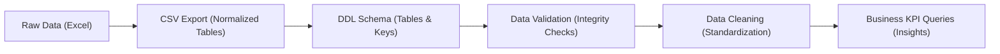

# 🏥 SQL Projects Portfolio

This directory contains production-grade SQL database projects. Each project encapsulates the complete database engineering lifecycle: from raw enterprise spreadsheets and normalized CSV exports to schema design (DDL), diagnostic validation queries, cleaning updates (DML), and executive business questions.

---

## 📁 Projects Summary

| Project | Database Name | Relational Tables | Focus Area |
| :--- | :--- | :--- | :--- |
| **[HealthPlus Care](./HealthPlus/)** | `Healthplus_care` | 17 tables | Outpatient clinics, telemedicine, specialist consultations, corporate health subscriptions, and claims |
| **[Medicare Hospital Analytics](./Medicare/)** | `HospitalAnalyticsDB` | 15 tables | Hospital operations, doctor workload, patient admissions, laboratory diagnostics, pharmacy, and insurance |

---

## 🔄 Project Lifecycle Workflow

Every SQL project in this portfolio follows a structured 4-stage pipeline:

1. **Schema Definition (`<Project>.sql`)**: Creates database, defines table schemas, primary keys, and relationships.
2. **Data Validation (`Data Validation.sql`)**: Assesses data health, detecting duplicates, NULL values, and referential integrity breaks.
3. **Data Cleaning (`Data Cleaning.sql`)**: Cleanses raw text, standardizes dates, and fixes inconsistencies.
4. **Business Intelligence (`Business Questions.sql`)**: Answers critical managerial, operational, and financial questions using advanced SQL.
