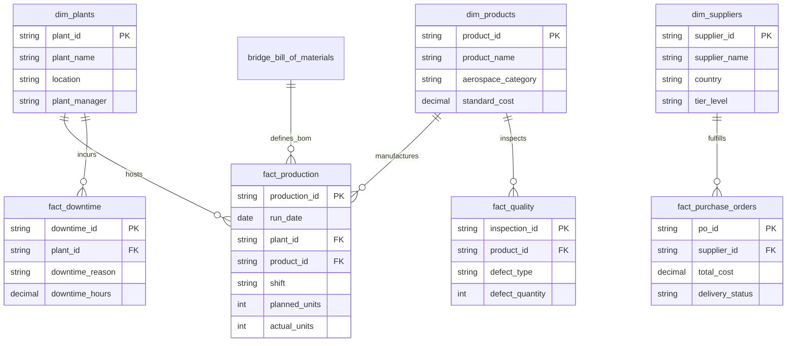

# ✈️ AeroHouse Manufacturing Power BI Analytics

Production-grade executive business intelligence dashboard and manufacturing operations model developed for **AeroHouse Manufacturing**, an aerospace component production facility.

---

## 📌 Project Overview

AeroHouse operates high-precision aerospace manufacturing facilities where operational efficiency, assembly tolerances, downtime minimization, and supply chain reliability are paramount. This Power BI project models manufacturing telemetry, production schedules, downtime incidents, component quality defect tracking, and supplier procurement into an interactive decision-support system.

---

## 🏗️ Data Model & Star Schema Architecture

The report connects operational fact tables and dimension entities modeled in Power BI:



---

## 📐 Core DAX Measures & Formulations

The model uses a centralized calculation table (`bridge_bill_of_materials`) hosting the core DAX measures:

1. **Total Planned Units**:
   ```dax
   Total Planned Units = SUM(fact_production[planned_units])
   ```
2. **Total Produced Units**:
   ```dax
   Total Produced Units = SUM(fact_production[actual_units])
   ```
3. **Production Achievement %**:
   ```dax
   Production Achievement % = 
   DIVIDE([Total Produced Units], [Total Planned Units], 0)
   ```
4. **Production Shortfall**:
   ```dax
   Production Shortfall = 
   [Total Planned Units] - [Total Produced Units]
   ```
5. **Total Defective Units**:
   ```dax
   Total Defective Units = SUM(fact_quality[defect_quantity])
   ```
6. **Defect Rate %**:
   ```dax
   Defect Rate % = 
   DIVIDE([Total Defective Units], [Total Produced Units], 0)
   ```
7. **Total Downtime Hours**:
   ```dax
   Total Downtime Hours = SUM(fact_downtime[downtime_hours])
   ```
8. **Procurement Spend**:
   ```dax
   Procurement Spend = SUM(fact_purchase_orders[total_cost])
   ```

---

## 🖥️ Interactive Dashboard Visuals & Layout

The dashboard is structured into a cohesive executive control page (`Page 1`):

* **Top Executive KPI Cards**:
  * **Production Achievement %**: Real-time attainment gauge against target schedules.
  * **Production Shortfall**: Unfulfilled unit deficit requiring rescheduling.
  * **Defect Rate %**: Quality benchmark tracking component rejection rates.
  * **Total Downtime Hours**: Aggregate lost manufacturing hours.
  * **Procurement Spend**: Total expenditure committed on supplier purchase orders.
* **Operational Analytical Charts**:
  * **Plant Production Target vs. Actual (Clustered Column Chart)**: Compares Planned vs. Produced output across manufacturing plant facilities (`dim_plants.plant_name`).
  * **Downtime Root Cause Analysis (Horizontal Bar Chart)**: Ranks stoppage categories by total hours lost (`fact_downtime.downtime_reason` - e.g., Tooling Wear, Unplanned Maintenance, Calibration Delay, Electrical Fault).
  * **Quality Defect Distribution (Donut Chart)**: Categorizes rejected aerospace components by failure mode (`fact_quality.defect_type` - e.g., Dimensional Tolerance, Surface Flaw, Porosity, Tensile Failure).
  * **Procurement Spend by Supplier (Line & Stacked Column Combo Chart)**: Analyzes procurement spend and fulfillment velocity across aerospace suppliers (`dim_suppliers.supplier_name`).
  * **Product Run-Rate (Line Chart)**: Tracks production velocity and unit output across aerospace product families (`dim_products.product_name`).
* **Dynamic Slicers**:
  * **Manufacturing Plant**: Filter views by individual production facilities (`dim_plants.plant_name`).
  * **Product SKU**: Filter by aerospace component name (`dim_products.product_name`).
  * **Operational Shift**: Drill down into Shift 1 (Morning), Shift 2 (Evening), and Shift 3 (Night).
  * **PO Delivery Status**: Filter by `On-Time`, `Delayed`, or `Pending` supplier deliveries.

---

## 🛠️ How to Open & Inspect

1. Launch **Microsoft Power BI Desktop**.
2. Open the file `C:\Angel\05_PowerBI\AeroHouse.Manufacturing.pbix`.
3. In the **Report View**, interact with slicers to observe dynamic DAX recalculations across visuals.
4. In the **Model View**, inspect table relationships, cardinality ($1:*$), and cross-filter directions.
5. In the **Data View**, inspect underlying facts and dimensions.
